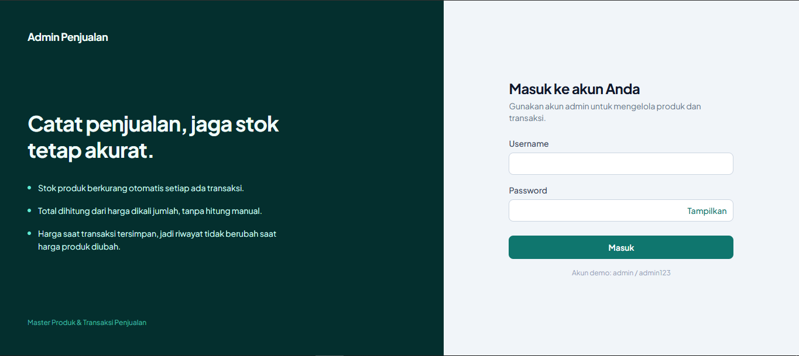
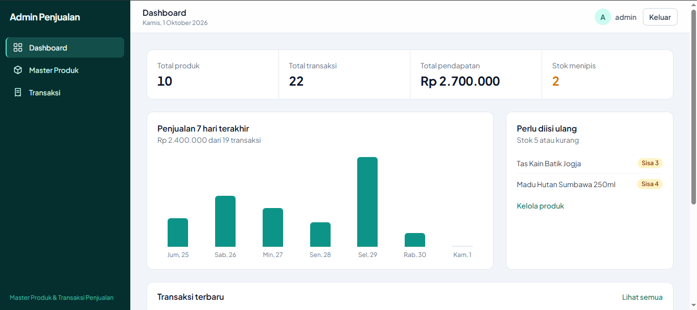
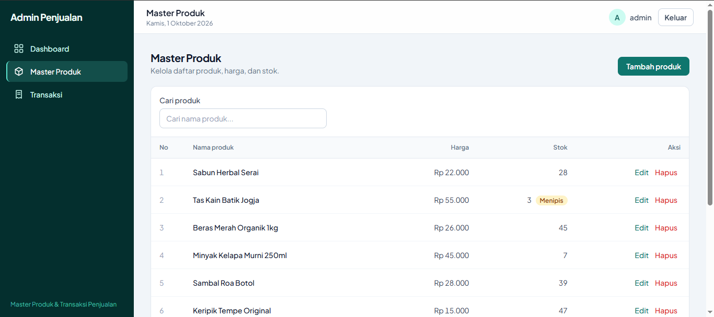
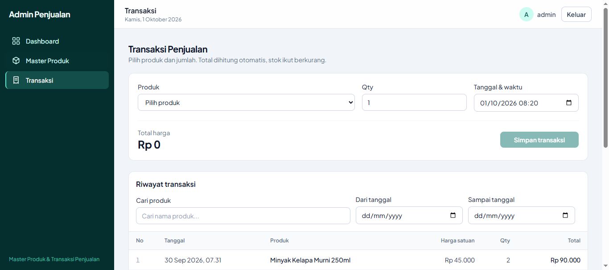
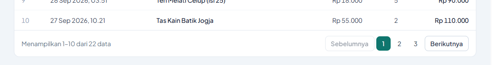
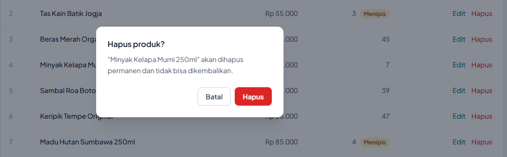
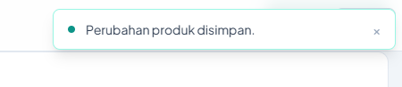

# Admin Panel Manajemen Penjualan - Frontend

Antarmuka admin untuk modul **Master Produk** dan **Transaksi Penjualan**.

**Stack:** Vue 3, Vue Router, Tailwind CSS, Axios, Vite.

## Fitur

- Halaman: Login, Dashboard, Master Produk, Transaksi, Logout
- Layout admin responsif: sidebar (drawer di mobile), navbar, area konten
- Route guard: halaman admin hanya bisa dibuka dengan token yang masih berlaku; sesi habis diarahkan ke login
- Master Produk: tambah, edit, hapus, **search** (debounce), **pagination**, penanda stok menipis/habis
- Transaksi: pilih produk dari master, total otomatis, **validasi stok** sebelum simpan, riwayat dengan pencarian, filter tanggal, dan pagination
- **Toast notification** dan **dialog konfirmasi** (untuk hapus) tanpa library tambahan
- Dashboard: total produk, transaksi, pendapatan, stok menipis, grafik penjualan 7 hari, transaksi terbaru

## Setup Frontend

Prasyarat: Node.js 18+ dan backend sudah berjalan.

```bash
# 1. Install dependency
npm install

# 2. Buat file .env
cp .env.example .env

# 3. Jalankan
npm run dev
```

Buka http://localhost:5173. Login default: **admin / admin123**.

## Screenshots

- Halaman Login  
  

- Halaman Dashboard  
  

- Halaman Master Produk  
  

- Halaman Transaksi  
  

- Paginasi  
  

- Konfirmasi Hapus  
  

- Notifikasi Toast  
  
